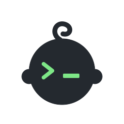

# Agent Baby Names

[](https://github.com/dblock/agent-baby-names/actions/workflows/test.yml) [](https://github.com/dblock/agent-baby-names/actions/workflows/lint.yml) [](https://github.com/dblock/agent-baby-names/actions/workflows/package.yml)

A plugin for Claude Code and GitHub Copilot CLI that names each new session after the project it works on, such as `📧 gmail-toggle`, using a naming strategy you can choose or write yourself. Read the [introductory blog post](https://code.dblock.org/2026/11/27/naming-claude-code-and-copilot-sessions-after-their-project.html) for the story behind it.

## Installation

The plugin needs Bash and [jq](https://jqlang.org/). On Windows it runs in Git Bash, which comes with [Git for Windows](https://gitforwindows.org/), and jq installs with `winget install jqlang.jq`; GitHub Copilot CLI runs hooks with the first `bash` on `PATH`, so set `COPILOT_BASH_PATH` to Git Bash's `bash.exe` if the WSL `bash` comes first. It is listed in the [dblock marketplace](https://github.com/dblock/agent-marketplace), which you add once.

### Claude Code

```sh
claude plugin marketplace add dblock/agent-marketplace
claude plugin install agent-baby-names@dblock
```

Claude Code 2.1.275 and later can also install it in one step from a session with `/plugin install agent-baby-names --marketplace dblock/agent-marketplace`.

### GitHub Copilot CLI

```sh
copilot plugin marketplace add dblock/agent-marketplace
copilot plugin install agent-baby-names@dblock
```

Copilot CLI runs plugin hooks only in folders you have trusted.

## Usage

Start a session and send a prompt. The first prompt of a session without a name gives it one, and later prompts and sessions you have named yourself are left alone.

By default, a session is named after a short topic of its first prompt, with an emoji, such as `🔊 loud-laptop-fan` for "why is my laptop so loud". The topic and emoji come from the host's small model, Haiku; use the `repo` strategy to name sessions after their repository without asking a model.

### Examples

<https://github.com/user-attachments/assets/a650ddbc-4070-443d-9946-073782ed6852>

<sub>Claude Code with `["git-clone", "topic", "emoji"]`: each prompt names a checkout, which becomes the session's name with an emoji.</sub>

<https://github.com/user-attachments/assets/18a7e7e6-b3e5-4364-b250-1a5111a56ed8>

<sub>Copilot CLI with `["git-clone", "topic", "emoji"]`: each new session renames itself, then starts on its prompt.</sub>

## Configuration

Configuration is optional and lives in `~/.config/agent-baby-names/config.json`, or under `XDG_CONFIG_HOME` when it is set. Set `AGENT_BABY_NAMES_CONFIG` to use another file.

```json
{
  "strategy": ["git-clone", "topic", "emoji"],
  "strategies": {
    "git-clone": { "root": "~/code" }
  }
}
```

`strategy` is a strategy or a list of strategies, each the name of a built-in strategy below or the path to [your own strategy](docs/strategies/custom.md), any executable that prints a name. The strategies run in order, and each one gets the name so far and keeps it or changes it, so this example names a session after a checkout in `~/code` that the prompt mentions or that it runs in, else a topic, and then puts an emoji before the name. `strategies` holds each strategy's options under its name.

### Built-in Strategies

- [`repo`](docs/strategies/repo.md) uses the repository the session runs in.
- [`git-clone`](docs/strategies/git-clone.md) uses a checkout named in the prompt, else the current one.
- [`github-repo`](docs/strategies/github-repo.md) uses one of your GitHub repositories named in the prompt.
- [`topic`](docs/strategies/topic.md) asks a model for a short topic.
- [`prompt`](docs/strategies/prompt.md) asks a model a question that you write.
- [`emoji`](docs/strategies/emoji.md) adds an emoji, such as `👋 hello-world`.
- [`directory`](docs/strategies/directory.md) uses the folder the session runs in.

## Contributing

See [CONTRIBUTING](CONTRIBUTING.md), [DESIGN](DESIGN.md), [RELEASING](RELEASING.md), [CHANGELOG](CHANGELOG.md), and [AGENTS](AGENTS.md).

## License

MIT, see the [license](LICENSE).
